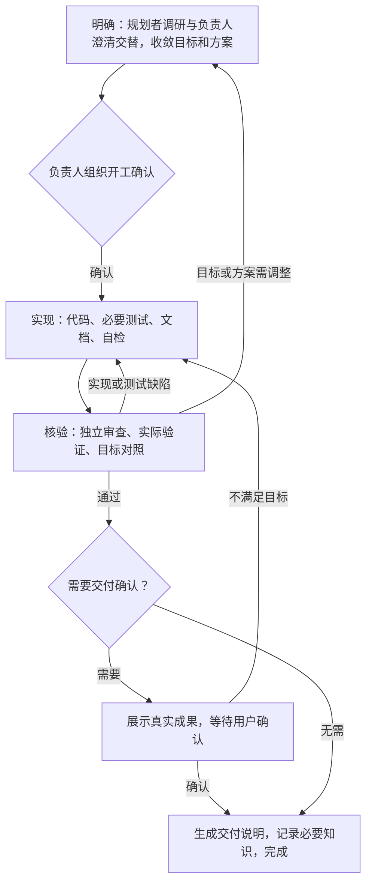

# dev-flow 极简工作流设计方案

日期：2026-11-19  
状态：设计稿，未改变技能执行行为  
范围：基于现有 dev-flow 收敛角色、阶段、产物和状态操作，吸收目标驱动优化提案

## 1. 结论与边界

现有流程确实偏重。建议将中大型任务的 7 个阶段收敛为 **明确 → 实现 → 核验**，将 7 套角色配置收敛为 **负责人、规划者、实现者、核验者**。所有任务使用同一条主流程，按影响面增加必要检查，不再维护 SOLO 和多角色两套执行路径。

精简对象是固定交接、重复文档、格式门槛和机械操作。保留需求与方案确认、范围约束、独立审查、真实验证、质量目标、人工验收、失败回退、断点恢复和执行审计；其中目前仅停留在约定或配置中的门禁需要落到状态转换校验。

技能名继续使用 `dev-flow`，保留用户已经熟悉的 `start / resume / status / abort`。内部角色和节点重新命名，不再使用 TASK 编号、Phase 0、SOLO、SUMMARY 等术语。

本次只提交设计，不修改脚本、配置、现有技能入口或安装副本，也不执行开发交付流程。

## 2. 现状判断

核对依据包括现有技能入口、阶段契约、角色配置、编排协议、状态脚本、审查与测试规则，以及 [devflow-skill-optimization-proposal.md](../../../skills/zh-CN/_archive/dev-flow/devflow-skill-optimization-proposal.md)。该提案中的历史任务复盘作为设计输入，本次未重新运行历史任务。

| 现状 | 造成的成本或缺口 | 本方案处理 |
| --- | --- | --- |
| 中大型任务经过需求、设计、实现、审查、测试、知识、总结 7 个阶段 | 低信息量阶段也需独立派发和交接 | 收敛为 3 阶段，保留阶段内的责任和检查 |
| 7 套角色配置包含独立知识与汇总角色，以及 SOLO 特例 | 同一任务重复加载上下文，分支规则增加 | 4 种职责，调研与方案由规划者负责，知识与汇总由负责人收尾 |
| 标准链路要求 9 份 Markdown 业务产物、6 份阶段结果 JSON，另有扫描与派发记录 | 事实被多次复述，报告之间可能不一致 | 4 个固定文件，其余只按证据需要生成 |
| 按预计文件数区分 small / medium / large | 文件少也可能涉及权限、迁移或复杂动效 | 按影响面确定检查项，文件数只辅助估算工作量 |
| 文档最少字数、固定章节、PT 至少 5 行伪代码 | 容易形成满足格式的填充内容 | 校验必需字段、覆盖关系和证据，不设字数或伪代码行数 |
| 启动协议一次要求读取 9 项资料，角色再读多份重叠规则 | 启动成本高，规则分散 | 短入口加当前职责、适用专项资料，规则单处维护 |
| `manual_gates` 存在于默认配置，但 `complete` 未消费该配置 | 配置看起来有门禁，流转没有强制执行 | 门禁作为推进状态的前置条件 |
| `confirm` 只接受配置了需求确认的阶段，不能恢复通用人工等待 | 既有提案中的设计与结果门禁尚无完整恢复路径 | 统一确认对象与等待状态 |
| `validate_plan_scope` 核对结果 JSON 上报的文件列表 | 不能单靠它证明实际工作区没有越界变更 | 结合启动基线、实际差异和上报列表进行核对 |
| Acceptance 表按 PT 查找含 `PASS` 的行 | 不能证明该 PT 下每条验收标准都被验证 | 每个验收项有独立 ID 和证据关联 |
| 审查清单包含通用质量与安全项，但偏重服务端，缺少视觉与动效检查 | 页面可能满足结构要求却偏离用户目标 | 增加按产物类型选择的检查内容 |
| 测试阶段在代码审查后补测试 | 新增测试文件没有天然包含在前一次审查范围内 | 实现阶段产出代码与必要测试，核验阶段检查同一份完整变更 |

现有测试规则已经要求按风险选择验证层级，也允许纯文档等变更不新增测试。这部分直接保留，不另造一套测试原则。

## 3. 新的角色与节点命名

### 3.1 四种职责

| 新名称 | 内部 ID | 职责 | 执行方式 |
| --- | --- | --- | --- |
| 负责人 | `owner` | 接收原始需求，持有用户目标，基于调研证据与用户沟通澄清，组织方案评审与确认，管理调度、状态、授权边界、交付和必要知识记录 | 固定为主线程 |
| 规划者 | `planner` | 从原始需求判断调研范围与顺序，查阅资料、代码与参照物，区分事实和待决问题，分析影响和风险，制定方案、实施步骤、改动边界与验收方式 | 默认独立 Agent，从明确阶段开始参与，无需先完成需求澄清；小任务仍保留该职责，产出可简短 |
| 实现者 | `builder` | 按确认方案实现代码、必要测试和受影响文档，完成自检与修复 | 默认主线程承担；需要隔离或分工时派发 |
| 核验者 | `verifier` | 独立检查实际变更、验收覆盖、代码质量和验证证据，执行必要复验 | 代码或行为变更使用独立 Agent；纯说明性变更可由负责人检查并明确为自检 |

角色表示责任，执行记录另存真实主线程或 Agent 身份。负责人兼任实现者时直接记录实际执行方式，不需要切换角色配置来模拟一个新 Agent。规划者对调研与方案负责，负责人检查方案是否覆盖用户目标及授权边界，并将需要用户决定的内容提交确认。

普通代码任务在没有失败重试时，通常增加一次规划派发和一次核验派发。跨模块、存在可独立写入的任务时可以拆分实现工作，但不设强制分工人数，不按规模自动创建完整团队。复杂专项可增加只读检查者，仍归入同一个核验阶段。

规划者自主查阅已授权范围内的必要资料和项目上下文，提交调研结论、需要用户决定的问题、方案和必要预览，不修改生产代码、测试或流程状态。需求澄清与调研可以交替进行，负责人不需要先把需求解释完整才能派发规划者。缺少独立 Agent 能力时，负责人可以明确登记兼任规划者，按相同要求完成调研与方案；这不满足核验阶段的独立审查要求。

核验者可以写核验结果和证据，不修改生产代码、测试或已确认目标。发现测试缺口或实现缺陷，返回实现者补充，再核验更新后的完整差异。

### 3.2 三个阶段

| 新名称 | 内部 ID | 合并的现有工作 |
| --- | --- | --- |
| 明确 | `DEFINE` | Phase 0、TASK-01、TASK-02；规划者调研与分析，负责人据此澄清，收敛后组织方案确认 |
| 实现 | `BUILD` | TASK-03、原 TASK-04 中的必要测试编写 |
| 核验 | `VERIFY` | CODE-REVIEW、TASK-04 的执行验证与结果验收 |

知识沉淀和总结是核验通过后的收尾动作，不增加阶段或角色。完成、等待、中止属于任务状态，不与阶段混用。

### 3.3 关键节点

| 现有叫法或隐含动作 | 新名称 | 含义 |
| --- | --- | --- |
| Phase 0 规模判定 | 上下文检查 | 找到代码、参照物、既有约束、验证入口与风险 |
| TASK-01 确认 + TASK-02 人工门禁 | 开工确认 | 用户确认目标、范围、方案及验收方式 |
| TASK-03 completed | 提交核验 | 实现者提交当前完整变更及自检证据 |
| CODE-REVIEW passed | 审查通过 | 独立审查子结论通过 |
| TASK-04 completed | 验证通过 | 适用的必需验证子结论通过 |
| TASK-04 后的目标确认 | 交付确认 | 用户确认实际成果，适用于感知类产物或明确要求人工验收的任务 |
| TASK-05 / SUMMARY completed | 交付完成 | 所有适用门禁通过，形成交付说明并记录必要知识 |

“审查通过”和“验证通过”分别保存结论，任何一项失败都不能交付。合并阶段只减少交接，不合并两种结论。

## 4. 主流程



### 4.1 明确

负责人把原始需求、已有对话、用户提供的资料入口、工作区及已知约束交给规划者，保留不确定内容，不先猜出完整需求。除必要的路径、访问或授权信息外，无需先向用户提问才能开始调研。

规划者根据原始需求自主决定在已授权范围内读哪些资料、查哪些代码、追哪些调用链以及何时补充调研。读取相关文档、代码、历史和参照实现无需逐项经过负责人审批；负责人提供调研边界并处理授权问题，不替规划者预列完整文件清单。

调研与澄清在明确阶段内形成一个短循环：

1. 规划者先查相关资料和现有实现，区分已证实事实、可继续查证的疑点与只能由用户决定的事项。
2. 能从代码、文档或可用资料确认的事实，继续查证；需要业务取舍、目标偏好或验收决策时，提交问题、事实依据、选项及影响给负责人。
3. 负责人检查现有对话是否已有答案，必要时向用户提问，再将回答原意反馈给规划者；不要求用户代查已有实现，也不自行替用户作影响目标的选择。
4. 规划者按回答补充调研并更新目标理解与方案。足以确定范围、可行方案和验收方式后，提交开工材料；仍存在会影响实现或验收的关键疑点时，不假定已收敛。

这个循环复用同一规划上下文，正常澄清不需要重新创建规划 Agent、不计为失败重试，也不增加阶段或正式报告。只有确实超出既有授权或需要受限访问、外部写入等操作时，才由负责人处理边界并取得必要授权；调研中发现新的相关文件本身不构成一次新的审批。

决策归属如下：

| 决策 | 负责方 | 判断边界 |
| --- | --- | --- |
| 查什么资料、读哪些实现、是否继续追查 | 规划者 | 在既有授权与相关性范围内自主决定，能说明调研与需求的关系 |
| 哪些事实已明确、哪些技术疑点需查证 | 规划者 | 提供来源与依据，不把猜测写成事实 |
| 是否需要向用户提问、如何组织问题 | 负责人 | 依据规划者证据和已有对话，只询问影响目标、范围、方案或验收的事项 |
| 业务目标、偏好、范围取舍和验收要求 | 用户 | 规划者给出建议与影响，负责人组织澄清与确认 |
| 是否扩大授权或进行有权限要求的操作 | 负责人组织，按既有授权或用户决定执行 | 规划者不能以调研名义扩大访问或写入权限 |
| 技术方案与验收方式是否足以提交确认 | 规划者提出，负责人复核 | 用户确认具体目标和方案后才能进入实现 |

最终形成可审阅的任务说明内容：

- 用户希望得到的结果、纳入范围、排除范围及不可改变的约束。
- 当前实现、可复用能力和关联参照物；先查用户指向的位置及项目内同类实现，再查明确相关的兄弟目录、历史或既有知识。记录查找范围和发现，不无界扫描整个磁盘。
- 拟采用的方案、预计改动边界、受影响契约和必要回滚安排。
- 逐项验收标准、对应验证方式、所需环境和哪些结果需要用户判断。

负责人复核这些内容是否忠实覆盖用户目标及授权范围，通过状态脚本登记并生成确认材料；需要修订时交回规划者，不另写一份重复方案。方案调整、调研补充及技术问题的分析仍由规划者负责，负责人负责沟通与流转。

每条验收标准使用稳定 ID，例如 `A1`、`A2`。实现、审查、验证和交付均引用同一组 ID，避免阶段之间重新降低目标。

按影响面列出适用检查，例如 API、数据、权限、并发、界面与交互、发布。允许同时适用多个检查内容；未知项需要查明或列为阻塞，不默认判为不适用。

小任务可以只有几条方案说明；涉及公共接口、迁移或复杂交互时再展开。无需为所有任务生成完整架构文档和文件级伪代码。

**开工确认默认一次展示目标和方案，一次确认同时覆盖两者。** 如果存在会影响方案的问题，先澄清目标再提交方案。用户明确要求目标、方案分别验收时分两次展示。已有对话中对同一版本内容的明确确认可以复用并登记，不重复询问；`auto` 或“继续”不能被解释为确认用户尚未看过的具体内容。

用户可以额外要求单独确认方案、审查结论或其他具体产物。已启用的人工门禁都必须实际等待并登记确认，保留原 `manual_gates` 的可配置能力；原配置中的审查后人工暂停建议改为按任务启用，独立代码审查仍是必需技术门禁。取消 `auto / manual` 两套流转语义，统一为非门禁动作自动推进、人工门禁按已确认配置执行。

### 4.2 实现

实现者依据已确认内容完成代码、必要测试和受影响文档，并记录实际改动与自检结果。

白名单覆盖生产代码、必要测试及文档。修改 HTTP API 时同步项目已有 API 文档；项目没有合适位置时再生成任务附属文档，不强制额外建立 API 文档 PT。

新增文件、修改范围或行为超出已确认边界时，先登记变更原因。实现细节调整由负责人核对是否仍在授权范围；需要修改方案时交由规划者分析并更新。改变目标、公开契约、风险或用户已确认方案的实质内容时，更新对应版本并重新确认。无需仅因多改一个文件就新建整个任务。

提交核验时检查实际工作区差异，包含已跟踪文件、新增文件、删除与重命名，并与任务启动基线和允许范围核对。启动时保留用户已有改动；同一文件存在用户与本任务混合修改而无法可靠归属时，保留现场并报告冲突，禁止通过重置或机械扣减文件列表来推断归属。

### 4.3 核验与收尾

核验者在当前变更快照上完成：

1. 核对目标、方案、改动边界、接口文档和验收项覆盖。
2. 独立审查代码与测试，检查适用的安全、数据、性能、可维护性及界面交互问题。
3. 执行能证明行为的必要检查；已有日志可信且对应当前快照时可引用，关键项按风险独立复验，不机械重跑全部命令。
4. 按验收 ID 给出实际结果与证据，列明失败、阻塞、未运行及非阻断建议。

代码或测试被修复后，旧核验结论失效；重新核验更新后的完整差异，可复用有明确未受影响依据的检查证据，不重复调研、确认和知识整理。

需要交付确认时，由负责人展示对应当前快照的实际成果。确认后生成交付说明，记录有复用价值且有证据的新知识；有新增时沿用 `{ARTIFACTS_ROOT}/knowledge/` 或项目已指定的知识位置，由负责人完成去重写入，没有新增时记“无新增”，不强制建立知识文件。沿用现有知识去重和适用边界要求。

## 5. 不可丢失的门禁

| 门禁 | 触发条件与通过标准 | 执行约束 |
| --- | --- | --- |
| 开工确认 | 已形成完整目标、范围、方案和验收标准，并取得对应内容的用户确认 | `DEFINE → BUILD` 时脚本检查确认记录与当前版本匹配 |
| 变更边界 | 实际差异符合已确认允许范围，用户已有改动受到保护 | 提交核验与交付前重新核对；越界未处理不得推进 |
| 独立审查 | 代码或行为变更有独立核验执行依据；无未解决 P0/P1，关键目标无缺口 | 实现者不能用自己的报告替代独立审查 |
| 真实验证 | 所有适用必需项实际通过，证据对应当前成果 | `failed / blocked / not-run` 均不满足必需项通过条件 |
| 目标达成 | 每个验收 ID 均有结论与有效证据，感知目标也被覆盖 | 不允许把核心目标缺失降级成普通风险后放行 |
| 交付确认 | 感知类产物或用户要求人工验收时，用户看过当前成果并确认 | 截图、录屏或预览与当前版本绑定；Agent 不代答 |
| 交付完整 | 适用文档已同步、所有必需门禁通过、交付说明已生成 | 收尾失败不标记完成，也不重新运行已通过的全部阶段 |
| 授权与审计 | 操作在授权范围内，执行记录真实，历史保留 | 不新增 commit、push、部署、外部写入的默认授权 |

检查项区分“适用且必需”“不适用”“非阻断建议”。不适用需给出事实依据，由核验者复核；不能将环境不可用写成不适用。需要改变已确认的验收范围时，明确修改目标并取得确认，保留原始未通过记录。

P2 可以作为建议保留，但评级不决定一切：即使被标为 P2，只要违反关键验收标准，仍然阻断。没有必要用风险条数上限替代这条判断。

宿主缺少独立 Agent 能力时，可以继续做准备、实现和自检，但代码或行为变更不能据此宣称“独立审查通过”。进入缺少独立核验的等待状态，待独立审查证据补齐后再完成；纯说明性任务按已声明的自检路径处理。

## 6. 吸收既有目标驱动提案

保留原提案对“流程合规但成果不满足目标”的核心判断。实现方式随主流程收敛，不直接将其 A—E 改造清单逐项叠加到旧状态机。

| 原提案内容 | 本方案落点 | 精简方式 |
| --- | --- | --- |
| 扫描已有参照物 | 明确阶段的上下文检查 | 结论进入任务说明，不新增 `phase0-scan.md` |
| 质量画像作为目标声明 | 验收标准中的感知目标 | 目标、证据要求及人工判断方式统一维护 |
| 目标、方案、结果三个确认锚点 | 开工确认覆盖目标与方案；交付确认覆盖实际结果 | 目标与方案可一次确认，保留分别确认的条件 |
| 设计稿或定帧预览 | 感知类任务开工确认材料 | 预览可直接复用到实现，不强制维护一次性静态 HTML |
| 视觉与动效审查 | 界面与交互专项检查 | 与通用审查并用，服务端检查按实际适用性加载 |
| 真实渲染、截图与量化断言 | 核验阶段的真实验证 | 静态画面用截图；动效另需时间采样、录屏或运行观察 |
| 目标达成度披露 | 交付说明按验收 ID 展示 | 直接引用核验结果，不再派汇总角色重新撰写 |
| `fail(user_gate) + confirm` 恢复 | 正常人工等待与确认机制 | 等待不记为失败，不消耗重试次数 |
| `conditional_sections` | 按适用检查生成验收要求 | 检查必需内容及证据覆盖，不用章节存在代替质量判断 |
| `manual_gates` 运行时执行 | 推进状态时统一检查门禁 | 不再按完成事件字符串维护第二套路由 |

感知类不限于前端代码，包括以外观、交互、动效、音视频或其他感知体验为主要交付目标的任务。界面与交互只是其中一个专项，其他媒介按实际验收方式扩展。

以“鹈鹕骑单车页面”为例，任务说明至少描述画布构图、主体与要素、风格参照、动效关系和不可缺失项。若目标含骑行动作，就应验收腿、踏板、曲柄的联动以及轮与路面的相对运动。具体数值和速度关系以设计模型为依据，不把案例中的某个数值写成所有动画的通用规则。

用户在开工前看过可判断风格与构图的预览，在交付前看过实际运行效果；截图不能证明动效正确，DOM 数量和正则检查也不能替代运行观察。没有渲染条件时如实阻塞所需验证，不生成“观感通过”的结论。

## 7. 产物与状态最小集

每个任务固定保留 4 个文件：

```text
artifacts/<task>/
  workflow-state.json   # 唯一可变流程状态：目标、方案、版本、门禁、执行和历史
  task.md               # 从已登记目标与方案生成的用户确认材料
  checks.json           # 核验者提交的逐项结果、审查结论和证据索引
  delivery.md           # 根据已登记实现摘要及核验结果生成的交付说明
  evidence/             # 需要时创建：命令日志、截图、录屏等
```

4 个文件是任务执行至收尾时的固定集合，启动时不创建空报告或空目录。API 文档、预览、迁移说明等只在适用时生成，优先使用项目已有位置。执行审计记录保留在状态历史中，原始证据按需放入 `evidence/`。

数据分工如下：

- 用户目标和约束由负责人整理，调研结论、方案、允许范围及验收方式由规划者提交，负责人复核后通过状态脚本登记；`task.md` 由同一份数据生成，避免手写两份契约。规划者不直接编辑状态，不增加一套独立阶段报告。小任务不要求伪代码，大任务可以引用附属设计材料。
- 实现者提交简短实现摘要、自检证据和变更说明，由负责人登记；不再要求一份 Markdown 报告加一份相同内容的阶段 JSON。
- `checks.json` 是核验输入，脚本校验并登记其版本、摘要与内容指纹；核验者不能借此直接推进流程或修改状态。纯说明性任务由负责人生成同一格式的自检结果，执行方式明确标注为自检。
- `delivery.md` 汇总已登记事实，包含成果、验收结果、未运行项、剩余建议与必要知识，不复制完整日志。
- 状态仅由 `workflow.py` 写入，历史只追加。报告与核验提交的历史版本保留在追加记录或按需证据文件中；重新生成当前视图不抹去旧确认、旧失败或旧结论。

每个验收项至少记录：ID、标准、验证方式、是否需要人工判断、结果及证据引用。检查返回 `passed / failed / blocked / not-run / not-applicable`，不允许用一条任务级 PASS 覆盖未检查的子项。

状态版本建议升为 `3.0`，明确表示阶段与契约已经改变。最少需要以下信息组，不再为每个历史角色保留固定状态对象：

| 信息组 | 内容 |
| --- | --- |
| 任务 | ID、工作区、创建时间、契约版本、当前阶段、运行状态 |
| 约定 | 当前目标与方案版本、验收项、允许范围、适用专项 |
| 基线 | 启动时工作区状态、用户已有修改、当前提交核验快照 |
| 门禁 | 所需门禁、状态、对应版本、确认人与依据 |
| 执行 | 主线程或 Agent、真实句柄、配置要求、实际提交和宿主回报 |
| 记录 | 实现摘要、核验证据索引、追加决策、尝试次数和错误 |

## 8. 状态推进、确认与恢复

### 8.1 单一推进入口

保留初始化、只读状态、派发准备与登记、确认、推进和中止等必要操作。移除单独规模分类，以及重复的路由表、角色到阶段硬编码和逐阶段结果包装。

阶段推进由一个入口完成：加载状态 → 检查前置门禁、当前快照、范围和核验证据 → 原子写入新状态。独立校验能力可以保留作诊断；正常执行不要求先调用一次只读校验再调用一次重复校验的完成命令。门禁校验始终在推进操作内部执行。

派发准备、真实宿主调用、登记返回句柄仍是有顺序的操作。准备记录不能证明 Agent 已启动；宿主调用失败也必须保留实际提交参数和失败记录。

### 8.2 等待与失败分开

- 阶段：`DEFINE / BUILD / VERIFY`。
- 运行状态：`active / waiting / failed / completed / aborted`。
- `waiting` 记录原因，如用户确认、环境、范围冲突、缺少独立核验或达到重试上限。
- 正常等待用户不写成测试或执行失败，不增加失败次数。
- 自动重试上限统一由一个配置来源管理，建议同一故障允许 2 次自动重试；修复后回核验仍计入对应修复链，不能靠往返阶段清空上限。
- 目标或方案调整返回明确阶段，由负责人澄清变化、规划者修订方案；实现缺陷返回实现阶段；单纯环境恢复只重跑受影响检查；收尾文件失败只恢复收尾。

### 8.3 确认与证据绑定版本

开工确认绑定目标与方案版本；交付确认绑定实际成果快照和展示证据。脚本将用户原话摘要、来源、时间和确认对象只追加登记。

代码与测试快照覆盖本次交付相关文件的内容及新增、删除、重命名；必需文档、预览及所引用证据也有版本或指纹。日志与运行状态等可变元数据不纳入源码快照，避免记录一次执行就使自身结论失效。

- 仅修改实现，不改变约定：保留开工确认，重新核验，并使受影响的交付确认失效。
- 改变目标、验收标准或实质方案：开工确认失效，重新展示受影响内容。
- 核验通过后又改代码、测试或成果：不得沿用旧核验与交付确认直接完成。
- 只修正交付说明中的非实质文字：不重跑测试，仍保留修订历史。

`resume` 先核对当前工作区、确认版本和证据有效性，再恢复到最近一个未满足条件的动作。不会因为曾写过 `passed` 就直接推进；`status` 保持只读，`abort` 保留现场并取消可控子 Agent。

### 8.4 执行审计保留

继续区分配置要求、真实提交和宿主回报，模型与推理等级分别记录。只有宿主明确回报的字段才能称“已确认”；继承且无回报就显示未知。

保留真实 Agent 句柄、隔离上下文、用户指定模型的处理边界、兼容档位调整和降级原因。主线程兼任职责不能宣称模型或推理等级已经按角色切换。正常启动一行播报，异常补一句；执行详情按需查看。

## 9. 技能包结构收敛

建议目标结构如下，文件数作为结构预算，不作为新的机械门禁：

```text
dev-flow/
  SKILL.md
  agents/openai.yaml
  assets/flow.json
  scripts/workflow.py
  scripts/tests/test_workflow.py
  references/owner.md
  references/planner.md
  references/builder.md
  references/verifier.md
  references/verification.md
  references/state.md
  references/execution.md
  references/adapters/codex.md
  references/specialties/...
```

- `flow.json` 汇集实际默认值、4 个职责配置、阶段与门禁定义。事实只维护一次，不再同时维护展示路由、机器路由和脚本中的阶段枚举映射。
- `SKILL.md` 只保留范围、4 个用户命令、3 阶段、门禁和读取条件，目标约 100–150 行。
- 职责提示各维护一份，不再分成内容重复的 `roles/` 与 `rules/`；通用核验规则集中在 `verification.md`。
- SQL、语言、界面与交互等专项按适用性保留并迁入 `specialties/`；不丢弃原有专项约束，也不要求所有任务预读。
- 宿主专有映射留在适配器；通用执行审计留在 `execution.md`。
- 角色解析可并入状态脚本的小模块，避免维护只服务于旧角色列表的独立注册表工具。

核心资料预计约 13 个文件，另计实际必要的专项资料；不以减少脚本行数为目标。工作区基线、原子状态写入、真实执行审计和证据失效检查仍需可靠实现。

技能继续只允许用户显式调用，保留 `disable-model-invocation: true` 与 `policy.allow_implicit_invocation: false`。不新增对其他手动技能的隐式调用；项目要求使用其他编码技能时，沿用已有明确授权或提示用户显式调用。

## 10. 实施与兼容策略

设计按整体方案验收，实施时按依赖完成以下工作，不在旧流程上先追加一批临时门禁：

1. 确定新阶段、角色、门禁与产物契约，建立单一配置来源。
2. 收敛状态脚本，实现版本化确认、实际范围检查、统一推进、正常等待和证据失效。
3. 合并职责资料，迁移必要专项与宿主审计规则，清理旧 TASK、SOLO 和多套路由引用。
4. 同步技能入口、宿主元数据、根 README 与使用说明，验证包内链接和配置。
5. 完成状态机关键检查及新会话演练后，再按授权备份、同步指定安装副本。

仓库当前只有中文 dev-flow 包，本方案不新增英文包。未来增加语言版本时按仓库约定配对维护。

新任务使用 3.0。历史任务不自动改写到新阶段，不因文档存在就推定新门禁通过。旧任务继续执行需使用原版本完整技能包，在同一安装位置按需切换；不同时安装两个同名技能，也不在新版本内嵌一套长期维护的旧引擎。新版本的只读状态查看可以识别旧版本并给出恢复说明。

现有根目录提案保留原文作为设计来源；正式实施时，将需要长期保留的设计资料归入 `docs/_archive/dev-flow/`，最终技能包根目录只保留 `SKILL.md`。本次不移动或覆盖该未跟踪提案。

## 11. 验收场景与精简效果

脚本行为发生变化时，为以下真实门禁行为做必要测试；不为命名、翻译或链接核对新增校验脚本。

| 场景 | 应有行为 |
| --- | --- |
| 小型代码修复 | 同一主流程；规划者形成简短方案，负责人组织确认，实现后独立核验，无 SOLO 报告 |
| 原始需求尚不清楚，但资料和代码可访问 | 规划者先自主调研，不要求负责人提前完成全部澄清或逐文件批准 |
| 歧义能由代码或资料查明 | 规划者查证并附依据，不转成让用户代查的问题 |
| 调研发现业务取舍或偏好问题 | 规划者提交依据、选项与影响，负责人向用户澄清，再交规划者继续调研并完善方案 |
| 调研需要额外访问或操作权限 | 负责人按已有授权处理，缺少必要授权时再向用户提出，不默认扩大边界 |
| 方案需要调整 | 规划者修订，负责人核对授权并组织必要确认，不增加新阶段或重复报告 |
| 纯说明性文档修改 | 可走负责人自检，不强制新增测试，不标为独立审查 |
| API 变更 | 契约与受影响文档同步，缺失或不一致时阻断 |
| 数据、权限或并发变更 | 加载适用专项并完成相应必要检查 |
| 鹈鹕骑单车页面 | 找到相关参照；开工展示目标与方案预览；核验有真实渲染和动效证据；交付前由用户确认 |
| 用户未确认开工内容 | 推进到实现被拒绝，等待不消耗重试次数 |
| 漏报越界文件或新增文件 | 依据实际工作区差异发现，不能靠删减 `files_changed` 放行 |
| 一条验收项未测、环境阻塞或核心目标缺失 | 不能用其他 PASS 或风险说明替代 |
| 核验者或实现者修改已通过快照 | 原核验失效，需要重新核对；核验者越权修改也须记录 |
| 用户确认后修改目标或实质方案 | 对应开工确认失效，历史保留 |
| 核验后更改代码或测试 | 核验和受影响的交付确认失效 |
| 宿主没有独立 Agent | 如实记录自检，必需独立核验保持未满足 |
| 额外启用审查结论人工确认 | 展示审查结论并等待实际确认，自动流转不能绕过 |
| 中断、重试、失败与中止 | 从未满足动作恢复，保留历史，不能重复登记或重置上限 |
| 模型、推理档位或宿主参数降级 | 实际请求、句柄与回报分别可追溯，不伪造生效结论 |
| 旧状态恢复 | 不静默迁移，不将旧记录冒充新门禁证据 |

预期结构变化：

| 指标 | 现有标准链路 | 本方案 |
| --- | --- | --- |
| 阶段 | 7，另有 Phase 0 与 SOLO 分支 | 3，统一主流程 |
| 角色配置 | 7 套 | 4 种职责 |
| 固定正式文件 | 9 份 Markdown + 6 份阶段 JSON，另有扫描与审计材料 | 4 个任务文件，证据和专项材料按需生成 |
| 默认额外 Agent | 中大型链路设计至总结通常 6 次阶段派发 | 普通代码任务通常 1 次规划派发 + 1 次核验派发，实现分工按需 |
| 感知类任务确认 | 原提案要求目标、方案、结果 3 个锚点 | 保留 3 个确认内容，通常合并为 2 次展示确认 |
| 常规阶段完成操作 | 角色校验，主线程完成时再校验 | 一次推进内置校验，独立诊断按需 |

这些是设计预算，尚未通过实现或实际任务测量证明耗时、Token 或质量改善。最终效果应在新会话中观察：材料更少、交接更少，目标没有丢失；必需门禁缺条件时推进必定被拒绝；成果满足用户看到并确认的目标。
